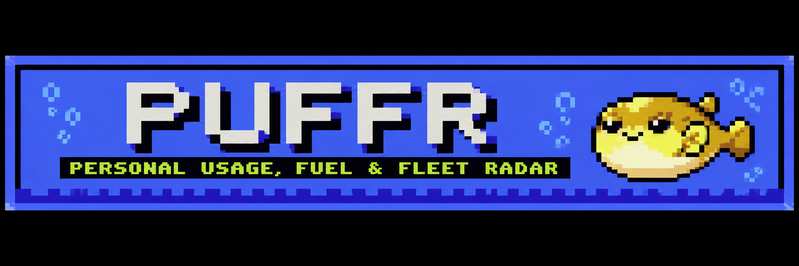

<p align="center">
  
</p>

# PUFFR: context, cost & fleet HUD for Claude Code


**Harness chrome for Claude Code.**
PUFFR: Personal Usage, Fuel & Fleet Radar.
Simple as Grokbot. Powerful as Hermes. Meme as OpenClaw. The *abunai* fish:
prepared wrong, it kills. So PUFFR watches your gauges, and it inflates as your context fills.

The fish is a pufferfish (*fugu* in Japanese), and abunai means dangerous, which is the point: a session
left alone burns money quietly, so this one sits in your statusline, counts every token you
spend, and tells you which habit cost what, with the receipts to back it.

```
🐡 Opus 5.5 [high · Explanatory] · 👤 you@example.com (max)
██░░░░░░░░ 17% 5h 62% ⏰1h30m →88% 7d 41% ⏰3d0h →71% cache 52m · $4.12
📁 puffr · main ✔
```

PUFFR is a Claude Code plugin. It doesn't wrap, patch, or proxy the `claude` binary. Everything
runs inside the unmodified CLI under your own login, reading files Claude Code already writes to
your disk. No OAuth token handling, no credential intermediation, no network calls. Just chrome.

## Install

Needs Claude Code, `jq`, and `node` 18+, on macOS or Linux.

```bash
npx github:Abunaico/puffr
```

That adds the `puffr-tools` marketplace, installs the plugin, points your statusLine at the HUD,
and offers the VS Code panel and a Warp side pane. Prefer to do it inside Claude Code?

```
/plugin marketplace add Abunaico/puffr
/plugin install puffr@puffr-tools
/puffr:hud install
```

Start a new session and the fish is there. Full options, updating, and uninstalling:
[docs/install.md](docs/install.md).

## What you get

| Piece | What it does | Docs |
|---|---|---|
| **HUD** | Three-line statusline: model, effort and output style, account; context bar, 5h and 7d rate meters with reset countdown and pace, prompt cache countdown, session cost; folder and git. The fish puffs as context fills. | [hud.md](docs/hud.md) |
| **Fleet rows** | Every running subagent as one fitted row: name, model, status, tokens, context %. | [hud.md](docs/hud.md#fleet-rows) |
| **Context viewer** | What is filling the context window, how the prompt cache is holding, and why it broke. | [context.md](docs/context.md) |
| **Burn report** | Where the tokens went, ranked by what you could save per month. By account, project, session name, agent, work type, model, and hour. Text, JSON, or one shareable HTML file. | [burn.md](docs/burn.md) |
| **Swarm readout** | How parallel a many-session run was: lanes, subagents, phases, cross-session messages, several machines, and a reconciliation against your bill. | [swarm.md](docs/swarm.md) |
| **Instruction cost** | What each always-on source (CLAUDE.md, rules, hooks, skill and agent listings, MCP instructions) costs per month. | [instructions.md](docs/instructions.md) |
| **Session radar** | Every Claude Code and Codex session on the machine: find, name, star, archive, assign, resume, fork, and save transcripts before the 30-day cleanup. | [sessions.md](docs/sessions.md) |
| **Accounts** | Every Claude Code login on the machine with its last-known 5h and 7d usage, side by side. | [accounts.md](docs/accounts.md) |
| **Panels** | The same dashboard in VS Code, a local browser page, or a terminal split, plus a read-only UCEF monitor view. | [panels.md](docs/panels.md) |
| **Watch** | Tells you in-session when another session finishes, errors, or stalls. | [sessions.md](docs/sessions.md#watch) |

## Commands

Inside Claude Code:

| Skill | Use it for |
|---|---|
| `/puffr:hud` | Check, install, repair, or remove the HUD statusline |
| `/puffr:layout` | List, switch, or make HUD layouts (`/puffr:compact` and `/puffr:detailed` are shortcuts) |
| `/puffr:settings` | Turn individual features on or off |
| `/puffr:context` | Context breakdown and cache report for this or any session |
| `/puffr:burn` | Cost and practices report; before and after a habit change |
| `/puffr:swarm` | Parallelism, lanes, phases, and messages across sessions and machines |
| `/puffr:instructions` | What your always-on instructions cost, per file |
| `/puffr:sessions` | Scan, name, star, archive, assign, save, and restore sessions |
| `/puffr:open` | Resume or fork a session in a new tmux or Warp pane |
| `/puffr:accounts` | Usage across every login on the machine |
| `/puffr:fleet` | Explain or tune the subagent rows |
| `/puffr:update` | Update every install; `check` only compares versions |
| `/puffr:off`, `/puffr:on` | Mute or unmute everything without uninstalling |
| `/puffr:help` | Every puffr command |

Every skill calls a plain CLI you can also run from any terminal: `puffr-burn`, `puffr-swarm`,
`puffr-context`, `puffr-sessions`, `puffr-accounts`, `puffr-instructions`, `puffr-config`,
`puffr-dash`, `puffr-update`, `puffr-help`. All of them take `--help`, and the reports take
`--json`. See the [command reference](docs/commands.md).

## A quick tour

PUFFR was built in Claude Code sessions with PUFFR running. One build session, priced by
`puffr-burn --project puffr --git`:

```
🐡 puffr burn: 2026-09-01 → 2026-10-07 · puffr · 1 sessions · $55.60 ≈ API list price

INSIGHTS                                                    saving / month
  1. Keep sessions shorter                                  ≈$646
     The average request re-reads 368k tokens of context; cache reads are 65% of spend.
  2. Run execution on Sonnet                                ≈$240
     $44.95 of your own edit and shell turns ran on Opus or Fable; the same tokens on Sonnet 5 cost $36.95.
```

One long Opus session carried 368k tokens into every request, and most of the spend was shell
work Sonnet could run. The rest of the story, from gauges to a shared HTML report, is in
[Building PUFFR with PUFFR](docs/tour.md).

## Documentation

Start at [docs/README.md](docs/README.md). The main pages:

- [Install, update, uninstall](docs/install.md)
- [HUD, layouts, and fleet rows](docs/hud.md)
- [Command reference](docs/commands.md)
- [Configuration: settings, environment, files](docs/configuration.md)
- [Privacy](docs/privacy.md)
- [Troubleshooting](docs/troubleshooting.md)
- [Development](docs/development.md)

## Privacy, in short

PUFFR reads transcripts and profile files that Claude Code (and Codex) already wrote, and writes
only to `~/.puffr` and `~/.cache/puffr`. It never reads or stores credentials. The only model calls
are Haiku calls through your own `claude` login: session autonaming (on by default, one switch to
turn off) and three opt-in features. Nothing else leaves your machine. Details:
[docs/privacy.md](docs/privacy.md).

## License

Free to use, modify, and remix, commercial or not, with attribution to Anthony Shafer and
[github.com/Abunaico/puffr](https://github.com/Abunaico/puffr). See [LICENSE](LICENSE).

PUFFR runs alongside Claude Code; it is not affiliated with or endorsed by Anthropic. Each user
authenticates with their own account. Don't point it at other people's sessions.

<p align="center">
  
</p>
